# E-Commerce

Full-stack e-ticaret platformu. Kitap, elektronik, kirtasiye ve daha fazla kategoride urun satis altyapisi sunar. Backend'de .NET 10 Minimal API, frontend'de Next.js 16 (App Router) kullanilmistir. Odeme entegrasyonu (iyzico), yapilandirilmis loglama (Serilog + Seq), arka plan is akislari (Hangfire) ve admin paneli gibi uretim ortamina yakin ozellikler icerir.

---

## Ekran Goruntuleri

### Ana Sayfa

Kampanya banner'lari, kategori navigasyonu, cok satan kitaplar, indirimdeki urunler ve yeni gelenler bolumlerini icerir.

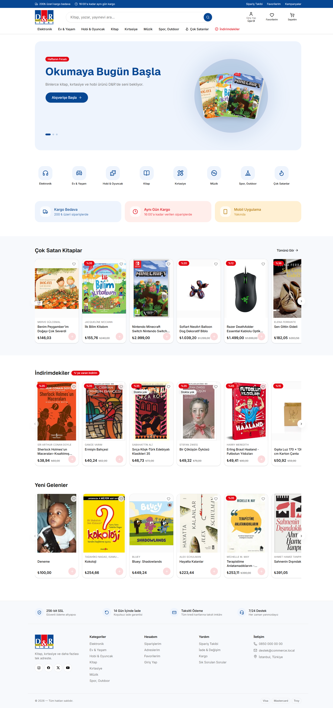

---

### Urun Detay

Urun gorseli, fiyat bilgisi, stok durumu, urun bilgileri (ISBN, sayfa sayisi, dil, basim yili, cilt tipi) ve benzer urunler karuseli.

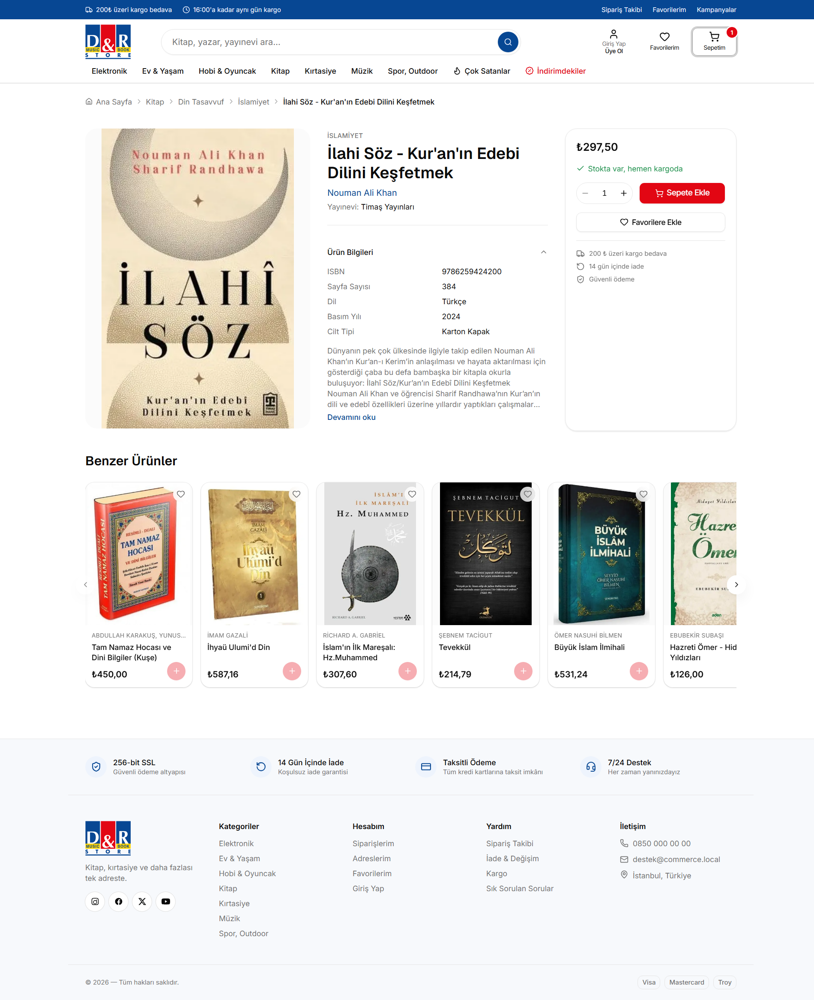

---

### Kategori Sayfasi

Sol tarafta fiyat araligi, stok filtresi ve siralama secenekleri; sag tarafta sayfalanmis urun listesi. Alt kategoriler arasinda hizli gecis.

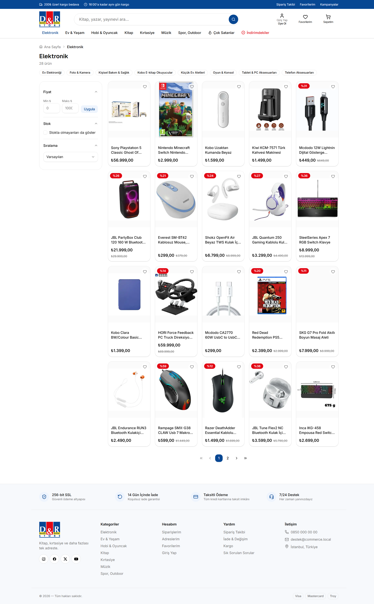

---

### Sepet

Slide-over sepet paneli. Urun adedi degistirme, kupon kodu uygulama, kargo bedava bildirimi ve siparis ozeti.

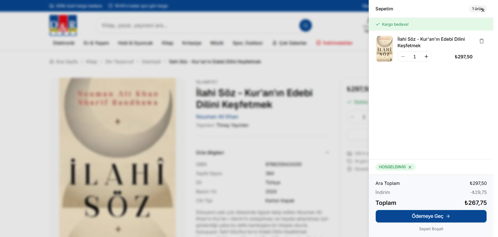

---

### Odeme Sureci -- Adres Secimi

Cok adimli odeme akisi. Kayitli adres secimi veya yeni adres ekleme, siparis ozeti.


---

### Odeme Sureci -- Kart Bilgisi

iyzico entegrasyonuyla kart bilgisi girisi. 3D Secure destegi, taksit secenekleri, siparis ozeti.

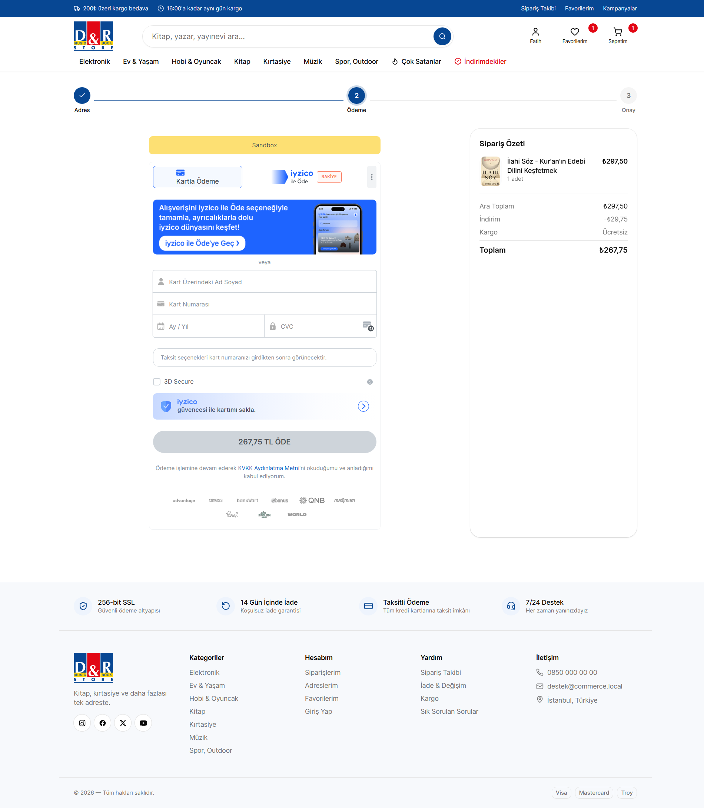

---

### Siparis Detay

Siparis durumu ilerleme cubugu (Beklemede, Odendi, Hazirlaniyor, Kargoya Verildi, Teslim Edildi), teslimat adresi, urun listesi ve fiyat dokumu.


---

### Siparislerim

Kullanicinin tum siparislerini listeleyen sayfa. Siparis numarasi, tarih, urun sayisi, tutar ve durum bilgisi.

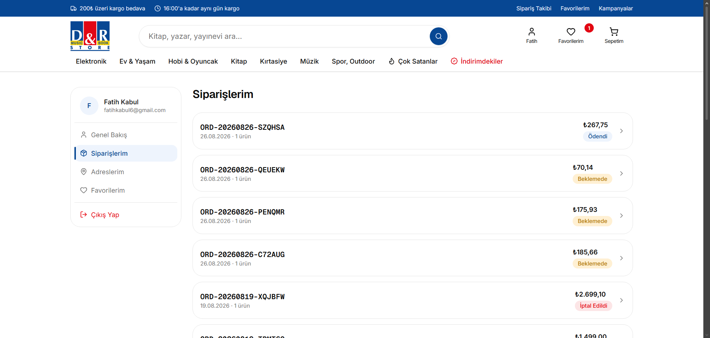

---

### Hesabim

Kullanici profil sayfasi. Toplam siparis, kayitli adres ve favori sayilari; son siparisler listesi.

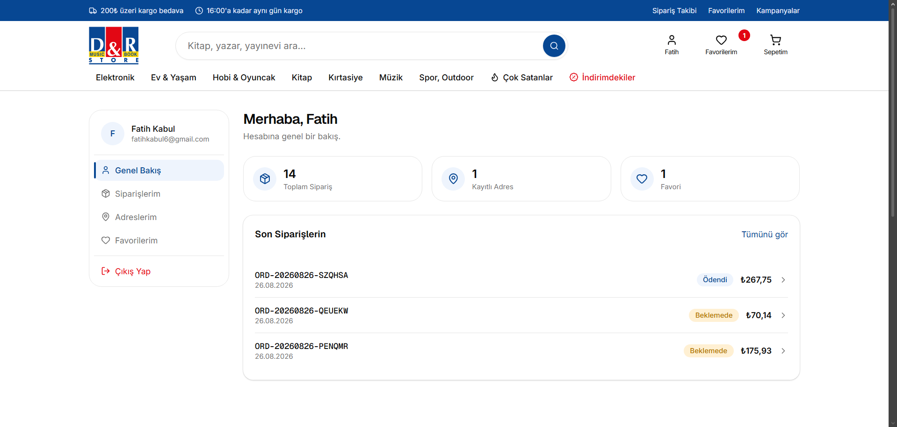

---

### Kayit Ol

Yeni kullanici kayit formu. Ad, soyad, e-posta ve sifre alanlari.

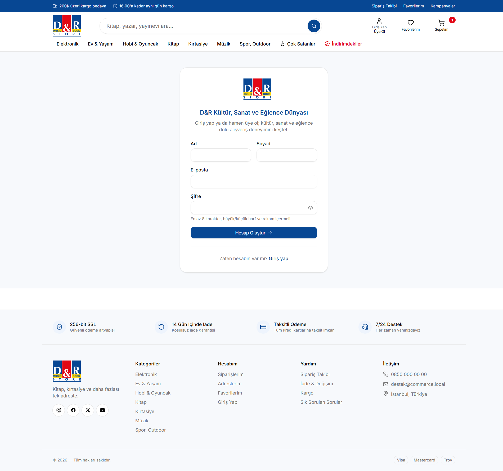

---

### Siparis Onay Maili

Siparis sonrasi otomatik gonderilen HTML mail. Siparis numarasi, urun detaylari, ara toplam, indirim, kargo ve toplam tutar bilgilerini icerir. Gelistirme ortaminda Mailpit ile yakalanir.

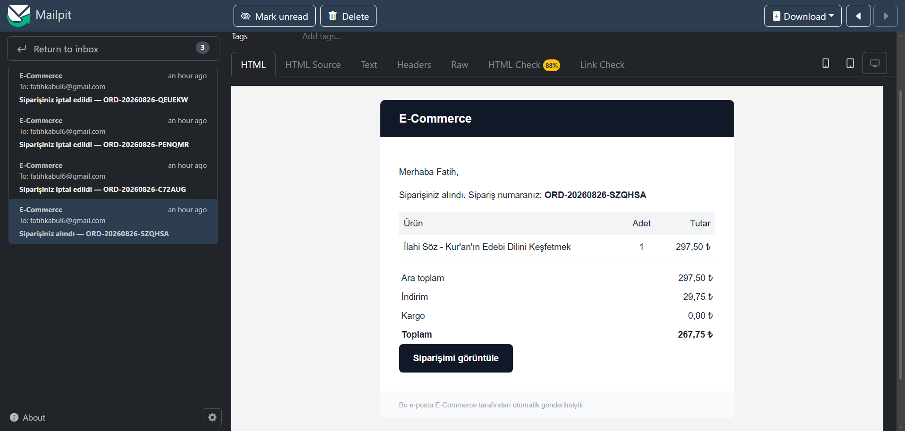

---

### Admin -- Dashboard

Toplam urun, siparis, ciro ve musteri sayilari. Son 30 gunluk satis grafigi, kategoriye gore urun dagilimi.

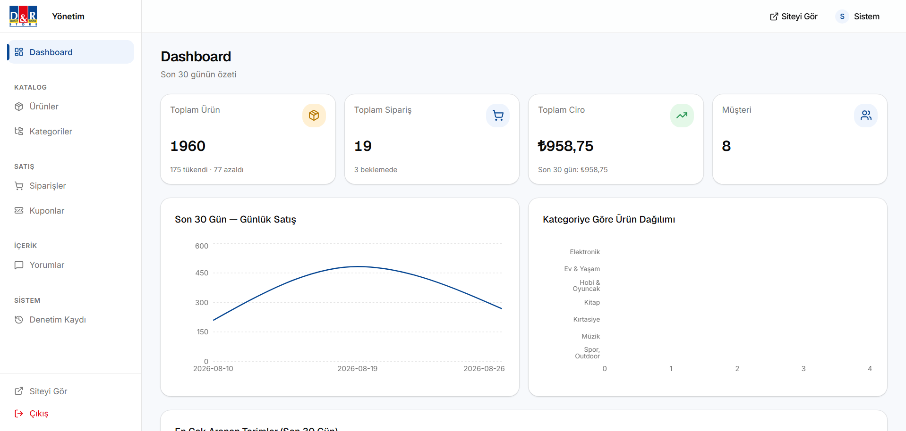

---

### Admin -- Urun Yonetimi

Sayfalanmis urun listesi. Ad, SKU, fiyat, stok, durum bilgileri. Arama, filtreleme ve siralama.

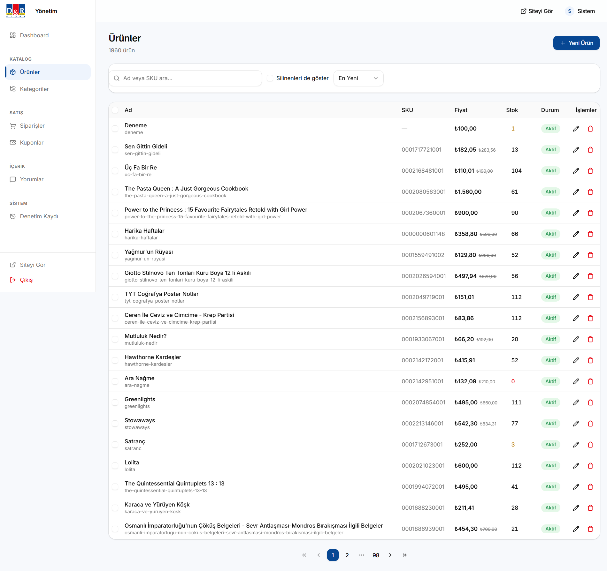

---

### Admin -- Urun Duzenleme

Urun bilgileri formu: ad, SKU, kategori, aciklama, fiyat ve indirimli fiyat, siniflandirma (yayinevi, marka), yayin durumu ve gorsel yukleme.

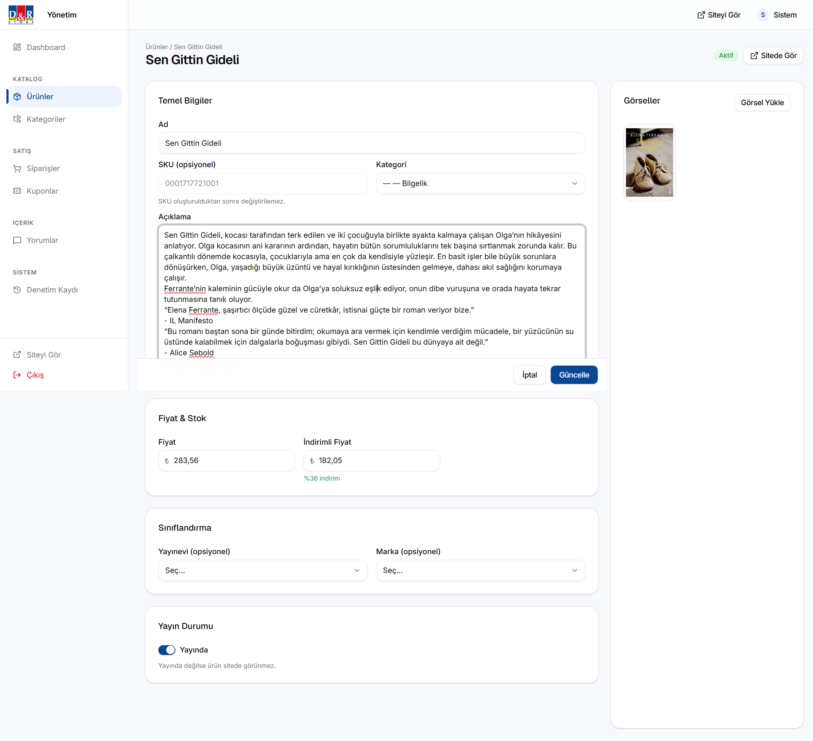

---

### Admin -- Siparis Yonetimi

Siparis listesi. Siparis no, musteri bilgisi, tutar, tarih, durum ve durum degistirme islemleri.

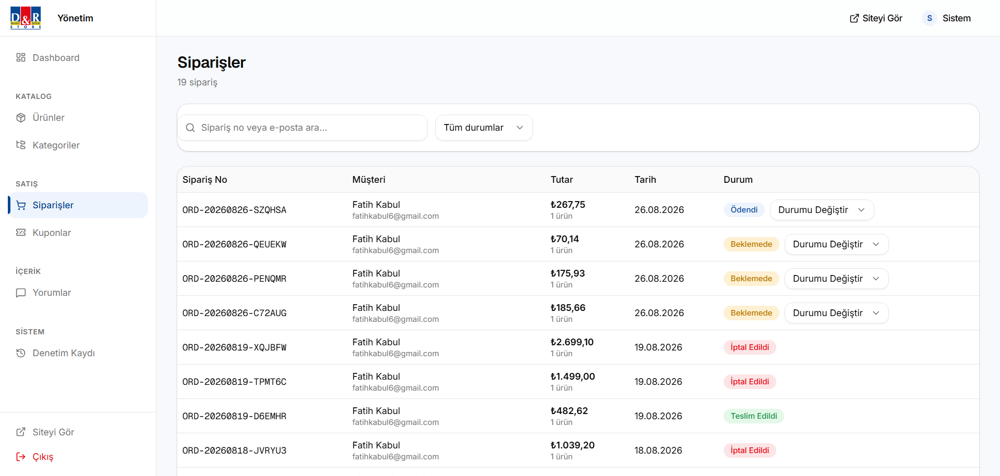

---

### Admin -- Kupon Yonetimi

Kupon kodlari, tipleri (yuzde/sabit tutar), deger, kullanim sayisi, gecerlilik tarihleri ve aktiflik durumu.

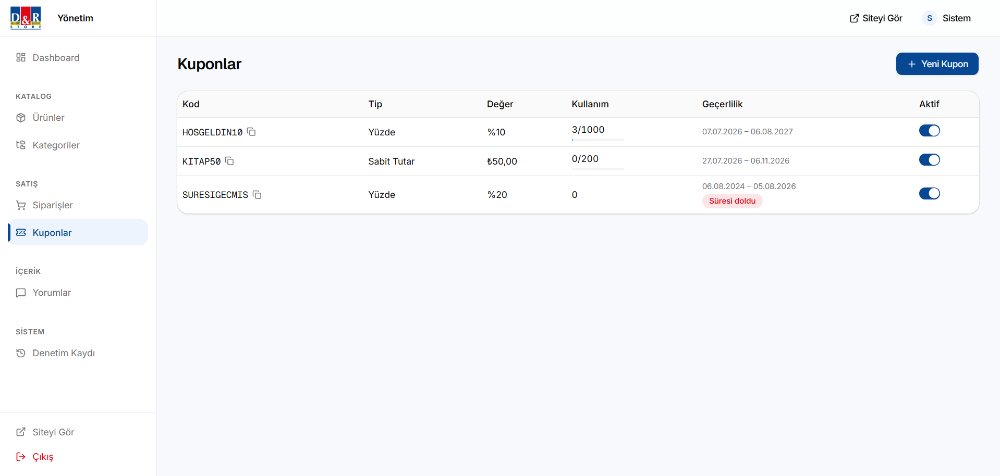

---

### Admin -- Denetim Kaydi

Admin islemlerinin kalici izi. Tarih, kullanici, varlik tipi, islem turu, degisen alanlar ve detay goruntuleme.

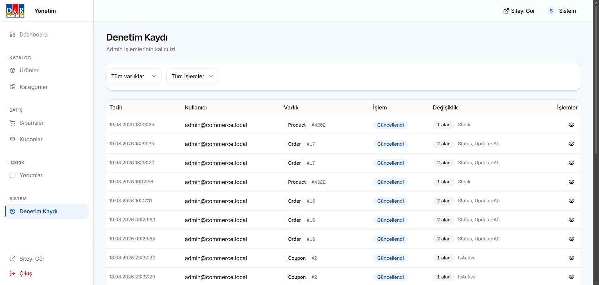

---

### API Dokumantasyonu (Scalar)

OpenAPI tabanli interaktif API dokumantasyonu. Tum endpoint'ler, istek/cevap semalari ve ornek kod parcalari.

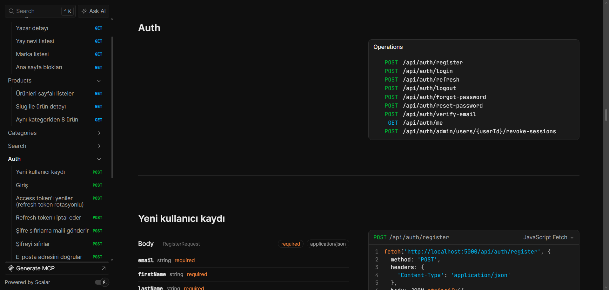

---

### Yapilandirilmis Log (Seq)

Serilog ile yapilandirilmis loglar. HTTP istek/cevap sureleri, veritabani sorgulari, hata ve uyari filtrelemesi.

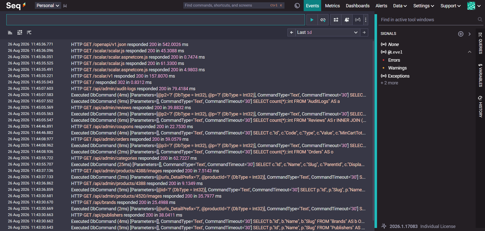

---

## Teknoloji Yigini

### Backend

| Kategori         | Teknoloji                    | Rol                                                      |
| ---------------- | ---------------------------- | -------------------------------------------------------- |
| Runtime          | .NET 10                      | Ana cati                                                 |
| API Stili        | Minimal API (MapGroup)       | Vertical Slice mimari                                    |
| ORM              | EF Core 10 + Npgsql          | Migration, LINQ, Postgres-ozel tipler (tsvector, JSONB)  |
| Veritabani       | PostgreSQL 17                | Iliskisel veri, full-text search, Hangfire deposu         |
| Cache            | Redis 7 + HybridCache        | L1 (bellek) + L2 (Redis), cache stampede korumasi        |
| Validasyon       | FluentValidation             | Kosullu kurallar, ozel hata mesajlari                    |
| Auth             | ASP.NET Identity + JWT       | Access token (15dk) + refresh token rotasyonu             |
| Arka Plan Isleri | Hangfire (Postgres depo)     | Mail, stok rezervasyonu, cron job'lar                    |
| Mail             | MailKit + Scriban            | SMTP gonderim + HTML sablon render                       |
| Gorsel           | Cloudinary                   | CDN, URL uzerinden donusum (f_auto, q_auto)              |
| Odeme            | iyzico (sandbox)             | 3D Secure, checkout form                                 |
| Arama            | PostgreSQL FTS               | tsvector + pg_trgm, yazim hatasi toleransi               |
| Loglama          | Serilog + Seq                | Yapilandirilmis log, traceId bazli filtreleme            |
| API Docs         | Scalar + OpenAPI             | Modern API dokumantasyonu                                |
| Mapping          | Riok.Mapperly                | Source generator, derleme zamani, sifir runtime maliyeti  |

### Frontend

| Kategori       | Teknoloji                     | Rol                                               |
| -------------- | ----------------------------- | ------------------------------------------------- |
| Framework      | Next.js 16 (App Router)       | SSR, ISR, dosya tabanli routing                   |
| Dil            | TypeScript (strict)           | Tip guvenligi                                     |
| Stil           | Tailwind CSS v4               | Utility-first CSS                                 |
| UI Bilesenleri | shadcn/ui                     | Kopyalanan bilesenler, tam kontrol                |
| Sunucu Verisi  | TanStack Query v5             | Cache, arka plan yenileme, loading/error yonetimi |
| Client State   | Zustand                       | Sepet, modal, tema gibi istemci durumu            |
| Form           | React Hook Form + Zod         | Dogrulama + tip cikarimi                          |
| Grafikler      | Recharts                      | Admin dashboard grafikleri                        |

### Altyapi (Docker Compose)

| Servis     | Imaj                 | Port      | Amac                        |
| ---------- | -------------------- | --------- | --------------------------- |
| PostgreSQL | postgres:17-alpine   | 5432      | Ana veritabani              |
| Redis      | redis:7-alpine       | 6379      | Cache + misafir sepet       |
| Mailpit    | axllent/mailpit      | 1025/8025 | Dev ortami mail yakalayici  |
| Seq        | datalust/seq         | 5341/8081 | Yapilandirilmis log arayuzu |

---

## Ozellikler

### Musteri Tarafi

- **Urun Katalogu** -- Kategori agaci, fiyat filtresi, stok filtresi, siralama secenekleri, sayfalama
- **Full-Text Arama** -- PostgreSQL tsvector + pg_trgm ile yazim hatasi toleransli arama ve autocomplete
- **Urun Detay** -- Gorsel, fiyat, stok durumu, ISBN/sayfa sayisi gibi kitap bilgileri, benzer urunler
- **Sepet** -- Misafir kullanicilar icin Redis, uye kullanicilar icin veritabani tabanli sepet. Kupon kodu destegi
- **Odeme** -- Cok adimli odeme akisi (adres secimi, kart bilgisi, onay). iyzico ile 3D Secure destekli odeme
- **Siparis Takibi** -- Siparis durumu ilerleme cubugu, detayli siparis gecmisi
- **Hesap Yonetimi** -- Profil, adres yonetimi, favoriler, siparis gecmisi
- **Kayit ve Giris** -- E-posta dogrulama, sifre sifirlama

### Admin Paneli

- **Dashboard** -- Ozet istatistikler, satis grafikleri, kategori dagilimi
- **Urun Yonetimi** -- CRUD islemleri, gorsel yukleme (Cloudinary), fiyat/stok/durum yonetimi
- **Siparis Yonetimi** -- Siparis listesi, durum gecisleri, arama ve filtreleme
- **Kupon Yonetimi** -- Yuzde veya sabit tutar indirimi, kullanim limiti, gecerlilik tarihi
- **Denetim Kaydi** -- Tum admin islemlerinin kalici izi, degisen alanlar, detay goruntuleme

### Teknik

- **BFF Deseni** -- Token'lar httpOnly cookie'de saklanir, JavaScript erisemez
- **Refresh Token Rotasyonu** -- Her yenilemede eski token iptal edilir
- **Optimistic Concurrency** -- Stok yarisi onleme (xmin + retry + CHECK constraint)
- **Idempotency-Key** -- Ayni siparisi iki kez olusturmayi onler
- **HybridCache** -- L1 bellek + L2 Redis, cache stampede korumasi
- **ISR/SSR** -- Urun sayfalari statik uretilip CDN'den servis, kategori ve arama SSR
- **Rate Limiting** -- Auth endpoint'lerine siki limit
- **Soft Delete** -- Silme yerine IsActive/DeletedAt
- **Audit Log** -- Admin islemlerinin otomatik kaydedilmesi
- **Problem Details** -- RFC 9457 uyumlu hata cevaplari

---

## Mimari

```
Backend:    Vertical Slice Architecture (Feature bazli klasorleme)
API:        .NET 10 Minimal API (MapGroup)
Frontend:   Next.js 16 App Router (SSR/ISR)
Tip Paylasimi: OpenAPI --> TypeScript (otomatik uretim)
```

### Backend Feature Klasorleri

```
Commerce.Api/Features/
  Admin/          -- Urun/siparis yonetimi, raporlar
  Auth/           -- Kayit, giris, token yenileme, sifre sifirlama
  BackgroundJobs/ -- Hangfire job tanimlari
  Cart/           -- Misafir (Redis) + uye (DB) sepet
  Catalog/        -- Urun, kategori, yazar, yayinevi
  Favorites/      -- Favoriler
  Orders/         -- Siparis olusturma, durum makinesi
  Payments/       -- iyzico entegrasyonu
  Search/         -- PostgreSQL FTS + autocomplete
```

### Domain Katmani

```
Commerce.Domain/
  Catalog/   -- Product, Category, Author, Publisher, BookDetails
  Common/    -- Base entity, enums
  Orders/    -- Order, OrderItem, Payment, Coupon
  Pricing/   -- Indirim ve kargo hesaplama kurallari
  Reviews/   -- Urun yorumlari
  Users/     -- User, Address, RefreshToken
```

### Web Sayfalari

```
web/src/app/
  (shop)/              -- Ana site layout'u
    page.tsx            -- Ana sayfa (ISR)
    urun/[slug]/        -- Urun detay (ISR)
    kategori/[slug]/    -- Kategori (SSR)
    arama/              -- Arama sonuclari (SSR)
    odeme/              -- Odeme adimlari
    hesabim/            -- Hesap, siparisler
  (auth)/               -- Giris/kayit
  admin/                -- Admin panel
  api/                  -- BFF route handler'lari
  sitemap.ts            -- Otomatik sitemap
  robots.ts             -- robots.txt
```

---

## Kurulum

### Gereksinimler

- [.NET 10 SDK](https://dotnet.microsoft.com/download)
- [Node.js 20+](https://nodejs.org/)
- [Docker](https://www.docker.com/) ve Docker Compose

### 1. Altyapi Servislerini Baslatin

```bash
docker compose up -d
```

PostgreSQL, Redis, Mailpit ve Seq container'lari ayaga kalkar.

### 2. Backend

```bash
dotnet run --project api/src/Commerce.Api
```

API varsayilan olarak `http://localhost:5000` adresinde calismaya baslar.

### 3. Frontend

```bash
cd web
npm install
npm run dev
```

Web uygulamasi varsayilan olarak `http://localhost:3000` adresinde calismaya baslar.

### Adresler

| Servis             | Adres                    |
| ------------------ | ------------------------ |
| Web                | http://localhost:3000     |
| API                | http://localhost:5000     |
| API Docs (Scalar)  | http://localhost:5000/scalar |
| Mailpit            | http://localhost:8025     |
| Seq                | http://localhost:8081     |


